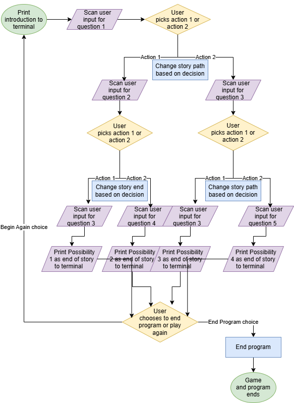

# Choose-Your-Own-Adventure-Game

This project is a choose your own adventure game that poses questions to the user about which actions they can take, and based of user choices, creates different story lines.

## The Problem

I am trying to create a project/game that a user, or multiple users, can quickly play in the terminal, without any prior knowledge or experience.

## How It Works

This software uses Java to create a multi-path program. The program starts by printing out context to the story and asking the user to choose action 1 or action 2. Each action the user takes brings the user to a different question and path. The program continues this way for multiple questions, and then ends, allowing the user to see the conclusion to their specifically chosen path. The user then has the option to quit the program or to restart the game.



## Tech Stack

- **Language:** Bash / Java 
- **Libraries:** Scanner

## Setup

```bash
git clone https://github.com/Camc135/Choose-Your-Own-Adventure-Game
cd Choose-Your-Own-Adventure-Game
```

## Usage


## Roadmap

- [ ] Create two paths for the user for each question
- [ ] Add 2 more questions/events
- [ ] Allow the user to play again or quit program

## Author

Campbell McWherter, https://github.com/Camc135
